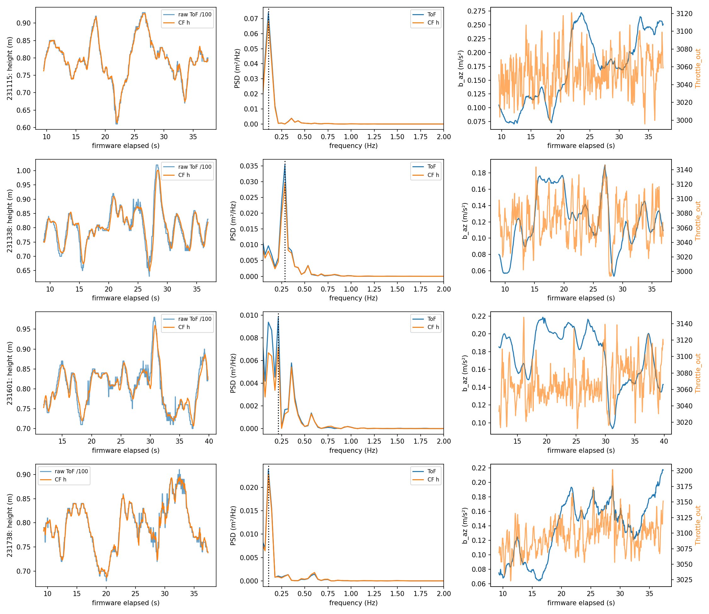

# B1: measured Z hover recordings, 2026-10-26

The recorded motion is dominated by **several-second variation**, supporting the
brief's slow H4 investigation branch, not establishing thrust-correlated bias as
its cause. The scaled runs peak near 3.50 s and 4.67 s. Both legacy runs peak at
the lowest searched frequency bin (about 0.107 Hz): **right-censored unresolved
slow drift/oscillation**, not a measured 9.35 s oscillator. H1/H2/H5 timing and
loop effects remain plausible contributors to slow closed-loop motion.

## Evidence and masks

Original inputs are read-only under
`D:/Projects/UAV_lab/FreeRTOS-adaptive-controller-codex/logs/`.
Campaign prefix is `campaigns/z-cf-hover_20261026-`; session prefix is
`sessions/20261026-`, with suffix `-z-cf-hover-001_f01_z_cf_hover`.
Flight name is `z-cf-hover-001` in each campaign.

| Campaign suffix | Session time | Logged CF mode | Campaign hold (s) | Analyzed firmware window (s) | Frames |
|---|---|---|---|---|---:|
| 231115 | 231021 | 0 legacy | 8.515–38.547 | 9.52–37.52 | 701 |
| 231338 | 231246 | 1 scaled | 7.906–37.937 | 8.92–36.92 | 701 |
| 231601 | 231506 | 1 scaled | 10.813–40.860 | 11.84–39.84 | 701 |
| 231738 | 231646 | 0 legacy | 8.313–38.375 | 9.32–37.36 | 702 |

Windows preserve the explicit bounds in each session's pre-existing
`cf_vz_check.json`, approximately one second inside each campaign hold edge.
Thus takeoff and landing are excluded; window choice is not a result selected
for a preferred spectrum. Coherent `slot1.*` records are grouped by receive
timestamp, then elapsed time comes from `xTickCount` (milliseconds), relative
to the first complete slot-1 frame. Unprefixed aliases and other slots are
excluded. All four masked streams have uniform 40 ms tick spacing (25 Hz),
no missing frame within the windows, and one unchanged logged CF mode.

## Spectrum and amplitude

**PROPOSED analysis choices:** Hann periodogram after linear detrending,
search 0.1–2 Hz, no zero-padding; compare full-window and further two-second
edge trims. Frequency bin spacing is about 0.0357 Hz, not an uncertainty bound.
Sine amplitude is a least-squares peak amplitude at the selected bin, with
offset and linear trend fitted jointly. It is not half the full excursion.
ToF is raw `ano_of.of_alt_cm / 100`; CF height is `alt_cf.h` in meters.

| Campaign | ToF / CF peak (Hz) | ToF / CF fitted peak amplitude (cm) | ToF / CF std (cm) | ToF min–max (m) | CF min–max (m) | ToF power below 0.5 Hz, within search |
|---|---:|---:|---:|---|---|---:|
| 231115 | 0.107 / 0.107, boundary | 5.84 / 5.59 | 6.25 / 6.04 | 0.61–0.93 | 0.613–0.927 | 98.1% |
| 231338 | 0.285 / 0.285 | 5.24 / 4.90 | 6.61 / 6.12 | 0.63–1.02 | 0.648–1.001 | 93.4% |
| 231601 | 0.214 / 0.214 | 3.30 / 2.77 | 5.41 / 4.87 | 0.70–0.98 | 0.706–0.960 | 93.0% |
| 231738 | 0.107 / 0.107, boundary | 4.39 / 4.26 | 4.92 / 4.81 | 0.68–0.91 | 0.687–0.895 | 90.5% |

With an extra 2 s removed at each edge, selected ToF bin periods become
8.01, 3.43, 8.01 and 8.03 s respectively. The scaled 231338 peak is relatively
stable; 231601 is multi-component/window-sensitive. Boundary peaks in the
legacy runs shift with record length, so neither warrants an exact period.
Strongest secondary-band bins in 0.5–2 Hz are 0.606, 0.535, 0.571 and 0.605 Hz;
their existence does not make them the dominant motion. The companion JSON
retains local peaks and mean-only detrending sensitivity.

## Relative lag and bias/throttle correlation

**PROPOSED analysis choices:** third-order zero-phase Butterworth bandpass
0.1–2 Hz on detrended raw ToF, CF h and CF vz; differentiate the filtered ToF
with a central numerical gradient, then discard another 1 s at each edge.
Overlap-normalized Pearson cross-correlation searches only ±0.5 s; positive
lag means CF follows ToF. No maximum hits the lag search boundary. Grid
resolution is 40 ms; these are descriptive relative lags, not sensor latency
calibration or confidence intervals. Shared ToF input makes h correlation high.

| Campaign | h lag (ms), r | vz vs dToF/dt lag (ms), r | b_az vs Throttle_out r | After linear detrend r | b_az min–max (m/s²) |
|---|---|---|---:|---:|---|
| 231115 | 40, 0.998 | 120, 0.560 | 0.258 | 0.172 | 0.071–0.272 |
| 231338 | 160, 0.996 | 160, 0.790 | 0.413 | 0.412 | 0.053–0.190 |
| 231601 | 160, 0.991 | 120, 0.543 | -0.075 | 0.069 | 0.094–0.219 |
| 231738 | 40, 0.996 | 200, 0.687 | 0.559 | 0.453 | 0.064–0.218 |

Bias/throttle entries use zero-lag Pearson over each full masked hold, with
and without linear detrending. The sign is inconsistent across runs and the
signals are autocorrelated, so no independent-sample significance claim is
made. Throttle is a closed-loop actuator response to height and velocity;
shared feedback, drift, battery state, attitude and vibration can confound
this correlation. It neither identifies acceleration rectification nor proves
that the bias state caused the height excursion. The four sequential flights
are not randomized repetitions and cannot rank the modes causally.

## Cadence and identifiability

| Campaign | CF corrections/s | alt_update_cnt increments/s | Observed raw-ToF value changes/s |
|---|---:|---:|---:|
| 231115 | 66.93 | 66.96 | 7.29 |
| 231338 | 69.00 | 69.14 | 10.32 |
| 231601 | 70.64 | 70.82 | 8.75 |
| 231738 | 70.86 | 70.83 | 8.31 |

Counter rates use total increments divided by elapsed firmware time; the
8-bit update counter is unwrapped modulo 256. Value-change counts are only
changes visible at telemetry instants: repeated 1 cm values and intervening
changes are invisible. They are **not the hardware sample rate**. These
measurements support H6's correction/event-rate mismatch concern, but cannot
show exactly which hidden sensor value each correction consumed.

At 25 Hz the Nyquist limit is 12.5 Hz. Low-frequency height motion is visible,
but no logged anti-alias guarantee exists: faster components can alias. The
200 Hz prediction steps, roughly 70 Hz correction events, impulses and
acceleration/vibration above Nyquist cannot be reconstructed. Telemetry does
not identify ToF internal latency or phase against independent height truth.
No causal claim, faithful CF replay, per-tick correction-step claim, or delay
setting follows from these recordings alone. A disarmed higher-rate hand
test and independent timing evidence would falsify alternative lag causes.

## Reproduction and engineering gates

Run `python tools/analyze_z_cf_b1.py --logs-root ORIGINAL_REPO/logs --output-dir docs/lab/assets/z-cf-rootcause`.
Measured details: [JSON](assets/z-cf-rootcause/z-cf-rootcause-B1.json).
Scoped verification: `python -m pytest tools/test_analyze_z_cf_b1.py -q`.
Tests check lag direction/units, known sine amplitude/period, rejection of
missing frames, report serialization and coherent slot isolation.

Gate 1: slow branch would be falsified by dominant 0.5–2 Hz power after
phase masking; it is not observed here. Gate 2: finite 28 s windows, 25 Hz and
shared sensor truth restrict identification. Gate 3: range is filtered before
differentiation. Gate 4: throttle, height feedback and bias are coupled in the
same closed loop. Gate 5: descriptive recorded-data analysis, no plant model.
Gate 6: offline evidence and synthetic analysis tests only; no bench or new
flight validation. Next gate question: what independent measurement would
separate thrust-induced accelerometer bias from throttle responding to height?
