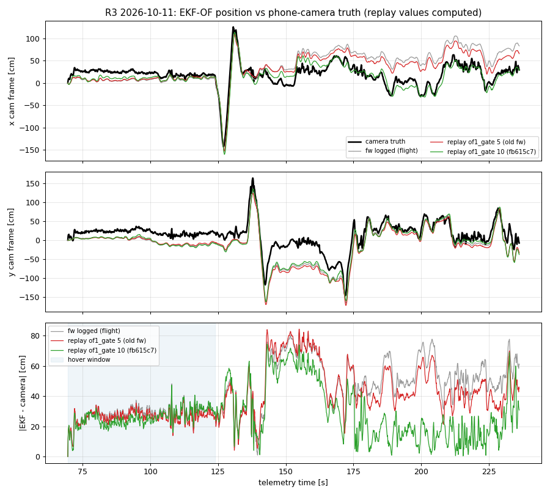

# R3 drift vs phone-camera truth (2026-10-11)

Flight R3 (2026-10-11, arm #2 tel 39.95-237.06 s, ended by an accidental kill at ~237.1 s).
Truth = phone camera (scrcpy) tracking the red motor rings, projected to the floor at telemetry Z.
All replay numbers below are **computed** (host replay of `API/ekf_of.c` via `ekf_of_replay.replay_truth`),
not flown. The fix is committed (fb615c7) but **not flashed**.

## Bottom line

| Question | Answer (computed) |
|---|---|
| Is the EKF error real or camera geometry? | Real: it depends on the path flown, not on where the drone is (revisit test). |
| Biggest lever | `of1_gate` 5 -> 10 sigma: rms 43.6 -> 32.4 cm, same-place revisit p90 55.5 -> 38.5 cm. |
| Hover drift | 0.42-0.46 cm/s in every variant tried (earlier camera-truth flights: ~1.6 cm/s). No EKF tuning moves it. |
| What fixes hover drift for good | An absolute position reference (camera / fiducial fusion). Not started. |

Think of the EKF as a walker counting steps with eyes half closed. The fix stops it from
ignoring its eyes whenever it turns fast. Each turn used to leave a stumble that never healed.

## Pipeline

- Camera: self-calibrated f = 940 px from the R3 video (`cam_r3_selfcal_2026-10-11.json`). Floor pose from ArUco id0
  (20 cm, the pad = world origin). Camera height 1.9 m (measured).
- Sync: video_t = tel_t + 15.05 s. EKF earth frame -> camera frame by a fitted rotation of -84.6 deg, scale 1.0.
- EKF earth path is rebuilt from the body-frame states: delta * 100 * 1.094, rotated by -yaw (as firmware `ano_of.earth_x/y`).
- Scripts: session scratch `o4j.py` (place-vs-path), `o4k.py` (robust scores), `o4p.py` (plot), `o4q.py` (height check).

## Findings

1. **Replay tilt sign bug (fixed in 2cf2f5e).** `replay_truth` used +sin(pit) for x. Firmware is
   `Gravity_Body_X = vecxZ = -sin(imu pit)`. Every grid scored before 2cf2f5e is invalid for x.
2. **The error is path-dependent.** An affine map of camera position (scale 1.06, rotation +1.9 deg,
   anisotropy -0.19) explains only part of it. When the camera sees the drone at the same place (<5 cm)
   more than 20 s apart, the EKF error differs by median 22.6 cm, p90 67.7 cm (fw logged). Camera geometry
   error would give the same error at the same place. So the EKF accumulates error along the path.
3. **The errors are born in fast RC moves** (plot, 128-145 s and 170-178 s). In hover the error barely changes.
4. **Mechanism.** The raw-flow anchor (`EkfOf_UpdateRaw`, of1) has no gyro compensation, no bias state and no
   rejection release. In fast moves the rotation flow pushes its innovation past 5 sigma. It is then dropped,
   one-sided, for the whole move. Each move leaves a position step that never heals.
5. **Takeoff camera artifact.** From 69.5 to 72 s the drone sinks from Z 1.1 to 0.84 m. The camera xy moves
   about 45 cm while the EKF says about 10 cm. The camera ray is about 55 deg off nadir (atan(2.70 m tape horizontal / 1.9 m height), computed), so a height error maps
   to 1.0-1.6 cm of floor error per cm (regression on Z, computed). Scores from 72 s on avoid this. It does not
   change the variant ranking.

## Scores (computed; firmware config, tilt gain 0.242)

aff = rms after removing an affine map of camera position. rev = same-place revisit error.

| Variant | rms | aff | rev med | rev p90 | hover cm/s |
|---|---|---|---|---|---|
| fw logged (flight) | 47.1 | 34.4 | 22.6 | 67.7 | 0.45 |
| replay, of1_gate 5 (old fw) | 43.6 | 29.8 | 23.3 | 55.5 | 0.42 |
| q_acc 1e-2 | 38.3 | 26.2 | 19.8 | 48.5 | 0.35 |
| R_of1 1e-2 | 43.4 | 22.0 | 16.7 | 41.2 | 0.44 |
| R_of1 1e-4 | 86.1 | - | - | - | - |
| of1_gate 6 | 33.6 | 24.5 | 17.3 | 44.6 | - |
| of1_gate 8 | 32.8 | 20.1 | 18.0 | 38.3 | - |
| **of1_gate 10 (fb615c7)** | **32.4** | **20.8** | **17.8** | **38.5** | **0.44** |
| of1_gate 12 | 37.0 | 21.1 | 18.5 | 37.6 | - |
| of1_gate 40 / off | 40.6 | 21.0 | 17.7 | 42.3 | 0.45 |

From 72 s on (takeoff artifact cut): rms fw logged 55.0, gate 5 48.9, **gate 10 26.3** cm.
Final error at 236 s: logged 60.7, gate 5 44.8, gate 10 30.7 cm.

Gates 8 to 12 are a broad optimum. 10 sits in the middle of it.

## What is still open

- **Hover drift of 0.44 cm/s** (about 26 cm per minute). It is unchanged by every gate, R and Q variant tried.
  The cause is UNVERIFIED. It is likely a flow bias (for example module gyro bias x height). The EKF cannot see
  this bias without an absolute reference: bof and ba are not separable in still hover
  (`docs/research/drift-of-sota-2026-10-11.md` section 2).
- **Absolute fix (proposed).** Fuse a camera position into the EKF: a ground-station ArUco/ring tracker, a WiFi
  uplink, and a delayed-measurement update with a short state history. This bounds drift by construction.
  It is a bigger change. Not started.
- **Keil build of fb615c7** is pending because the uVision GUI held `OBJ/`. The gcc `-Werror` golden tests pass
  (14).

## R4 flight plan (proposed)

1. Flash the Keil build of fb615c7 (or newer) at the start of the lab session. Disarmed, as usual.
2. Camera: same phone pose, record the whole battery. Then do a lens recal wave with the ChArUco board.
   The operator measures the id0 black square and a ring diameter with tape.
3. Flight script, one battery:
   - takeoff, then **90 s pure hover** with sticks centred (hover drift; expect about 0.44 cm/s, computed);
   - 4 x (RC move about 1 m out, back to the pad, 15 s hold) (revisit test; expect revisit p90 below 40 cm);
   - land with the landing switch (not the kill switch). Tape-measure the touchdown point from the pad centre.
4. Analysis: rerun `o4k`-style scoring on the R4 video. Success = revisit p90 and rms at least 30% below R3 logged
   (67.7 / 47.1 cm). Hover drift is reported, not judged: no change is expected from this fix.
